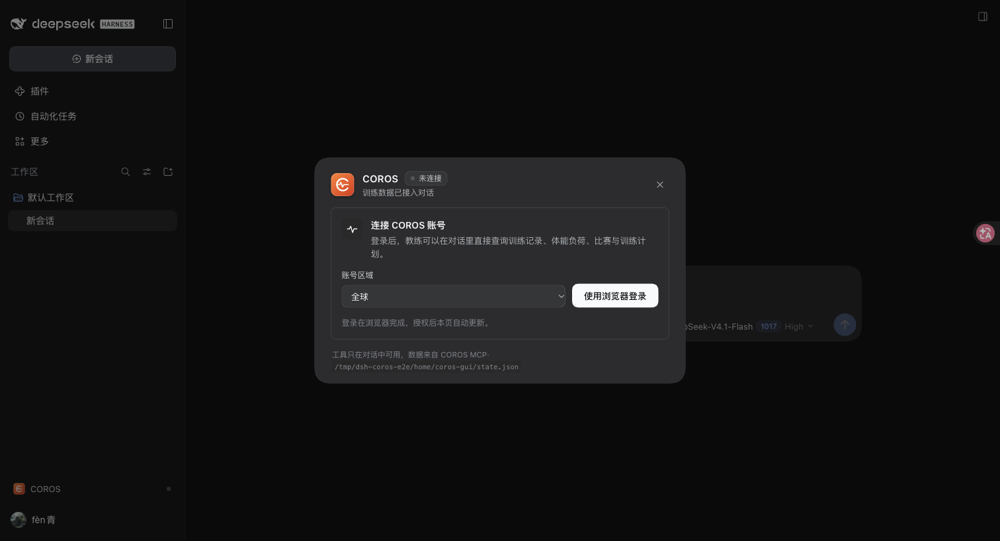

# dsh-coros-gui

把 COROS 训练数据接进 [DeepSeek Harness](https://github.com/deepseek-ai/deepseek-harness) 对话的插件：
浏览器 OAuth 登录一次，之后就能在对话里直接让教练查询活动、健康、体能负荷与训练计划。



## 功能

- **浏览器登录（重点）**：点一次「使用浏览器登录」，插件会向 COROS 官方授权服务申请一个一次性登录会话，
  在浏览器完成 COROS 账号授权后自动回调并保存令牌，全程不需要复制密码或回调地址。
- **对话内可用**：登录后 COROS MCP 的工具会以 `coros_<tool>` 的形式注册到 Harness，模型可以直接调用；
  未登录时提供 `coros_status` / `coros_login` / `coros_call_tool` 三个引导与兜底工具。
- **原生插件 UI**：遵循 DSH 插件规范，提供
  - 设置页「COROS」：连接状态、账号区域、登录/取消/退出、工具目录检索与参数查看；
  - 会话侧栏快捷入口与浮层面板：不打断对话即可查看连接状态、随时登录；
  - 会话头部状态 chip：当前 COROS 连接状态一眼可见。
- **四个账号区域**：全球 / 中国大陆 / 欧洲 / 美国，自动做 OAuth 发现并对齐区域。
- **令牌自动续期**：访问令牌到期前自动用刷新令牌续期（COROS 的刷新令牌会轮换，插件已处理）。
- **数据只在你本机**：令牌保存在 `~/.dsh/coros-gui/state.json`（目录 0700、文件 0600，原子写入），
  不经过任何第三方服务器；请求直连 COROS 官方 OAuth / MCP 域名。

## 安装

要求：DeepSeek Harness **0.2.x**（在 0.2.1-rc.3 上完成端到端验证）。

### 方式一：从本地目录安装（开发/自用）

```sh
# 使用 DSH 自带的 CLI（桌面版可用 app 内的 dsh-desktop-host/lib/cli.js）
dsh plugin --profile desktop add /path/to/dsh-coros-gui
```

安装完成后 DSH 会热加载插件（无需重启应用）。如果没有看到入口，重启一次 DSH 即可。

### 方式二：从 GitHub 安装

```sh
dsh plugin --profile <你的 profile> add github:ppxinashin/dsh-coros-gui
```

### 方式三：在 DSH 插件市场 / 插件管理器里安装

插件包已声明 `dsh.bundle.patch` 与 `dsh.client`，可以直接被插件管理器识别。

## 使用

1. 打开侧栏底部的 **COROS** 按钮，或「设置 → COROS」。
2. 选择账号区域（默认「全球」，会自动发现你账号所在的授权集群），点 **使用浏览器登录**。
3. 在弹出的 COROS 授权页完成登录与授权，回到 DSH 后页面会自动刷新为「已连接」。
4. 在对话里直接说：

   > 用 COROS 查一下我最近 7 天的跑步记录，按配速和心率帮我分析一下。

   > 看看我这两周的睡眠和 HRV 变化，和训练量有什么关系？

   > 我 8 周后要跑半马，基于我最近的训练给我排一个训练计划。

## 提供的工具

| 工具 | 说明 |
| --- | --- |
| `coros_status` | 查看 COROS 连接状态、区域、可用工具数量（未登录时也可用） |
| `coros_login` | 生成浏览器登录链接并开始等待授权（未登录时也可用） |
| `coros_call_tool` | 用原始 MCP 工具名 + JSON 参数调用，作为兜底 |
| `coros_<name>` | 登录后按 COROS MCP 工具目录自动注册，例如 `coros_get_activities` |

工具目录可在设置页检索，展开可看到每个工具的参数 JSON Schema。

## 登录与隐私

- 插件使用 COROS 官方 OAuth（授权码 + PKCE + 动态客户端注册 + CLI 登录会话轮询），
  与 COROS 官方 `coros-mcp` CLI 使用同一套协议。
- 授权范围：`openid offline_access mcp.tools`（读取个人信息、运动数据；写入训练计划需要你的账号授权）。
- 本地状态文件：`$DSH_HOME/coros-gui/state.json`（默认 `~/.dsh/coros-gui/state.json`），只含客户端注册信息与令牌，
  从不写入日志、工具输出或对话内容。
- 退出登录会清除本地令牌；重新登录只需再点一次「使用浏览器登录」。

## 兼容性与已知限制

- 需要 DSH `>=0.2.0`；UI 使用 DSH 主题 token（`--dsw-*`），自动适配明暗主题。
- 登录 RPC 仅在本机回环（loopback）绑定的 DSH Host 上启用；通过局域网/公网访问的 DSH 会提示不可用。
- 插件不实现 MCP Resources / Prompts，只桥接工具（与 DSH 官方 MCP 客户端一致）。
- COROS 侧工具集合由官方 MCP 服务决定，插件只做发现、命名规范化和参数 schema 清洗。

## 开发

```
dsh-coros-gui/
├─ lib/index.js          # Host 半：固定/动态工具、登录轮询、/api/coros-gui/* RPC
├─ lib/coros-engine.js   # COROS OAuth + MCP JSON-RPC 引擎（纯 Node，可单测）
├─ lib/client.js         # Web 半：手写 CommonJS 工厂 bundle（只依赖 React）
├─ cordis.patch.yml      # bundle patch：插入 coros-gui 行
├─ locale/{zh,en}.json   # 插件管理器展示用的标题/描述
├─ icon/icon.svg         # 插件图标
├─ test/engine.test.mjs  # 引擎单测 + 真实 COROS 端点 live smoke
└─ docs/CONTRACT.md      # 实现契约（协议、API、状态机、验证标准）
```

```sh
npm run check   # 三个 JS 文件语法检查
npm test        # 引擎测试：本地 mock + 真实发现/注册/登录会话冒烟
```

Host 半刻意不 import 任何 `@deepseek-ai/*` 包（只依赖 Node 内置模块），避免与宿主运行时版本耦合；
Web 半手写 `window.__ModuleLoader__.load({ id, factory })` bundle，无构建步骤，只 `require('react')`。

## English

A DeepSeek Harness plugin that connects your COROS training data to the conversation.
One browser OAuth login, then COROS MCP tools are registered as `coros_*` tools for the agent,
plus a native settings page / quick panel for login, region selection, status and tool browsing.
Tokens stay local at `$DSH_HOME/coros-gui/state.json` (0600). Requires DSH 0.2.x (verified on 0.2.1-rc.3).

## License

MIT
